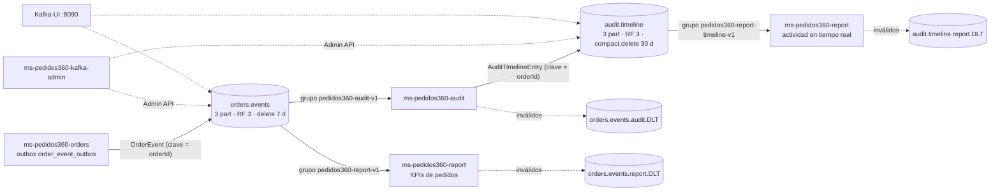

# Kafka en Pedidos360 (EP5 DSY1107)

Kafka transporta los **eventos de negocio** (qué pasó con cada pedido) para alimentar la **auditoría** y la
**reportería en tiempo real**, sin bloquear el núcleo transaccional. RabbitMQ sigue transportando los **comandos**
(tareas que alguien debe ejecutar: correo, ticket de cocina, boleta). Ambos conviven sin depender uno del otro:
Orders guarda el pedido y, en la misma transacción, sus mensajes salientes en dos outbox separadas
(`notification_outbox` → RabbitMQ y `order_event_outbox` → Kafka). Si Kafka cae, RabbitMQ sigue publicando y viceversa.

| | RabbitMQ (EP3) | Kafka (EP5) |
|---|---|---|
| Modelo | Cola de trabajo: cada comando lo procesa un consumidor y se elimina | Log de eventos: cada grupo lee todo el historial a su ritmo (offsets) |
| Uso | Comandos `email.send`, `kitchen.ticket`, `invoice.gen` | Eventos `orders.events` y línea de tiempo `audit.timeline` |
| Fallas | NACK → DLX → DLQ | Reintentos acotados → `<tópico>.<servicio>.DLT` |
| Reproceso | Replay desde la DLQ (mq-admin) | Reinicio de offsets del consumer group (kafka-admin) |

## 1. Arquitectura



Infraestructura (`compose.kafka.yml`): **Zookeeper + tres brokers** `confluentinc/cp-kafka:7.9.2` (Apache Kafka 3.9,
la última línea compatible con Zookeeper; Kafka 4.x solo funciona en modo KRaft). Valores del clúster: factor de
replicación 3, `min.insync.replicas=2`, creación automática de tópicos desactivada. Con `acks=all` el clúster
tolera la caída de un broker sin perder mensajes confirmados.

## 2. Tópicos y parámetros por flujo

Los crea y actualiza `kafka-init` con [`infra/kafka/create-topics.sh`](../infra/kafka/create-topics.sh) (idempotente:
si el tópico existe, reaplica su configuración).

| Tópico | Particiones | RF | min.insync | cleanup.policy | Retención | Por qué |
|---|---|---|---|---|---|---|
| `orders.events` | 3 | 3 | 2 | `delete` | 7 días | Fuente de verdad de cambios de pedidos; 3 particiones = hasta 3 consumidores en paralelo por grupo; la clave `orderId` mantiene el orden por pedido |
| `audit.timeline` | 3 | 3 | 2 | `compact,delete` | 30 días | Historial consultable por pedido: la compactación conserva la última entrada de cada pedido y la retención limita el tamaño |
| `orders.events.audit.DLT` | 3 | 3 | 2 | `delete` | 14 días | Eventos que Audit no pudo procesar (inspección/reproceso) |
| `orders.events.report.DLT` | 3 | 3 | 2 | `delete` | 14 días | Eventos que Report no pudo procesar |
| `audit.timeline.report.DLT` | 3 | 3 | 2 | `delete` | 14 días | Entradas de la línea de tiempo que Report no pudo procesar |

## 3. Productores y consumidores

| Servicio | Rol | Tópico | DTO | Serialización | Consumer group |
|---|---|---|---|---|---|
| orders | Productor | `orders.events` | `messaging/OrderEvent` | `StringSerializer` + `JacksonJsonSerializer` (sin headers de tipo) | — |
| audit | Consumidor | `orders.events` | `dto/OrderEvent` | `ErrorHandlingDeserializer` → `messaging/OrderEventDeserializer` | `pedidos360-audit-v1` |
| audit | Productor | `audit.timeline` | `dto/AuditTimelineEntry` | `DelegatingByTypeSerializer` (DTO → JSON) | — |
| report | Consumidor | `orders.events` | `dto/OrderEvent` | `ErrorHandlingDeserializer` → `messaging/OrderEventDeserializer` | `pedidos360-report-v1` |
| report | Consumidor | `audit.timeline` | `dto/AuditTimelineEntry` | `ErrorHandlingDeserializer` → `messaging/AuditTimelineDeserializer` | `pedidos360-report-timeline-v1` |

- **Separación de responsabilidades:** los `@KafkaListener` (`OrderEventListener`, `AuditTimelineListener`) solo reciben
  el DTO y delegan en servicios de dominio (`AuditStore`, `ReportProjection`, `ActivityMetricsService`). Audit publica la
  línea de tiempo a través del puerto `service/TimelinePublisher`, implementado por `messaging/KafkaTimelinePublisher`.
- **Cliente Kafka:** toda la configuración está en `application.properties` de cada servicio: `bootstrap-servers` a los
  tres brokers, serializers, `group-id`, `auto-offset-reset=earliest`, commit manual por mensaje (`ack-mode=record`),
  `isolation-level=read-committed`, `CooperativeStickyAssignor`, `session.timeout.ms`, `heartbeat.interval.ms`,
  `max.poll.interval.ms`, `concurrency=3`. En el productor: `acks=all`, idempotencia, `max.in.flight=1`, `lz4` y timeouts.
- **Contrato:** `OrderEvent` v1 ([KAFKA_EVENTOS.md](KAFKA_EVENTOS.md)) y `AuditTimelineEntry` v1 (`schemaVersion, entryId,
  sourceEventId, orderId, actorId, action, previousStatus, status, occurredAt, recordedAt, traceId, origin`). La validación
  es estricta: campos exactos, sin coerción de tipos, Bean Validation y transición de estado coherente.

## 4. Consumer groups

- **Cada responsabilidad tiene su grupo** (pub/sub): Audit y Report leen *todos* los eventos de `orders.events`, cada uno
  con sus propios offsets; uno puede estar caído o atrasado sin afectar al otro.
- **Report usa dos grupos**: la proyección de pedidos y las métricas de actividad avanzan por separado; reiniciar uno
  (por ejemplo para recalcular métricas) no reprocesa el otro.
- **Balanceo y resiliencia:** con `concurrency=3` cada instancia abre un consumidor por partición. Si se levanta otra
  instancia del mismo servicio con el mismo grupo (por ejemplo Report con `java -jar` en otro puerto y el mismo
  `REPORT_KAFKA_GROUP`), Kafka reparte las 3 particiones entre ambas; si una cae, sus particiones se reasignan a la otra
  (rebalanceo cooperativo con `CooperativeStickyAssignor`, sin detener a los demás consumidores).
- El lag de cada grupo se ve en Kafka-UI, en `GET /api/v1/kafka-admin/consumer-groups/{groupId}` o con `infra/kafka/inspect.sh`.

## 5. Manejo de errores

`DefaultErrorHandler` en `config/KafkaConsumerConfig` de audit y report:

| Situación | Decisión | Registro |
|---|---|---|
| Payload que no cumple el contrato (`DeserializationException`) | Sin reintentos → `*_rejections` + DLT del consumidor | `WARN [DLT] ... motivo=INVALID_EVENT` |
| Evento válido pero imposible de registrar (`InvalidEventException`: clave distinta, conflicto de eventId/versión) | Sin reintentos → `*_rejections` + DLT | `WARN [DLT] ... motivo=EVENT_CONFLICT` |
| Base de datos o Kafka no disponibles (transitorio) | Reintentos con backoff exponencial 1 s → 30 s, **sin límite**: el evento no se pierde ni se salta | `WARN [RETRY] ... transitorio=true` |
| Otro error inesperado | 3 reintentos (1 s, 2 s, 4 s) → `*_rejections` + DLT | `WARN [RETRY]` y `WARN [DLT]` |

- El mensaje a la DLT conserva el payload original (bytes) y headers con la excepción, tópico, partición y offset de origen
  (`DeadLetterPublishingRecoverer`). El consumidor continúa con el siguiente mensaje: un mensaje defectuoso no detiene el flujo.
- La idempotencia (`ON CONFLICT DO NOTHING` por `eventId`/`entryId`) hace seguras las reentregas.
- En Audit, la publicación en `audit.timeline` ocurre dentro de la transacción del registro: si Kafka no confirma, se revierte
  y el evento se reintenta.

## 6. Métricas en tiempo real

- `GET /api/v1/reports/summary` y `/lead-time` (EP2): KPIs de pedidos desde `orders.events`.
- **Nuevo** `GET /api/v1/reports/activity?minutes=60` (rol ADMIN): desde `audit.timeline`, acciones por tipo, los 10 actores
  más activos, acciones por minuto y `lastRecordedAt` (frescura de los datos).

## 7. Administración

- **`ms-pedidos360-kafka-admin`** (puerto 8087): crear, listar, modificar configuraciones, aumentar particiones y eliminar
  tópicos; listar consumer groups, ver su lag por partición, reiniciar offsets (EARLIEST/LATEST/TIMESTAMP) y eliminarlos.
  Ver su [README](../ms-pedidos360-kafka-admin/README.md) y la colección
  [Pedidos360-KafkaAdmin](../postman/Pedidos360-KafkaAdmin.postman_collection.json).
- **Kafka-UI** (`compose.kafka-ui.yml`, http://localhost:8090, login `KAFKA_UI_USERNAME` / `KAFKA_UI_PASSWORD`): brokers,
  tópicos, mensajes y consumer groups.
- **Scripts replicables:** `infra/kafka/create-topics.sh` (crear/actualizar tópicos) e `infra/kafka/inspect.sh`
  (brokers, tópicos, configuraciones y lag de los grupos):
  ```bash
  docker compose -f compose.kafka.yml run --rm --entrypoint bash kafka-init /opt/pedidos360/inspect.sh
  ```

## 8. Cómo levantar

Solo Kafka + Kafka-UI + kafka-admin:
```bash
docker compose --env-file .env -f compose.kafka.yml -f compose.kafka-ui.yml -f compose.kafka-admin.yml up -d --build
```
Solución completa (PostgreSQL, catálogo, pedidos, RabbitMQ, notificaciones, Kafka, auditoría, reportes y consumidores RabbitMQ):
```bash
docker compose --env-file .env -f compose.postgres.yml -f compose.catalog.yml -f compose.orders.yml -f compose.rabbitmq.yml -f compose.notify.yml -f compose.kafka.yml -f compose.events.yml -f compose.kafka-ui.yml -f compose.kafka-admin.yml -f compose.audit.yml -f compose.report.yml -f compose.commands.yml up -d --build
```
`compose.events.yml` activa la publicación de Orders en Kafka (`ORDERS_EVENTS_ENABLED=true`).

## 9. Guion de demostración

1. Kafka-UI → *Brokers*: 3 brokers; *Topics*: los 5 tópicos con su retención y cleanup policy.
2. Crear un pedido, aceptarlo y entregarlo (frontend o BFF). En Kafka-UI → `orders.events` → *Messages*: los eventos con clave = id del pedido, todos en la misma partición.
3. `GET /api/v1/audit/orders/{id}`: historial del pedido. Kafka-UI → `audit.timeline`: las entradas publicadas por Audit.
4. `GET /api/v1/reports/summary` y `GET /api/v1/reports/activity?minutes=60`: KPIs y actividad actualizados en segundos.
5. Kafka-UI → *Consumers*: los tres grupos con lag 0.
6. Producir un mensaje inválido en `orders.events` (Kafka-UI → *Produce Message*, valor `{"invalid":true}`): aparece en
   `orders.events.audit.DLT` y `orders.events.report.DLT`, en los logs (`[DLT]`) y en `*_rejections`; los consumidores siguen.
7. Detener un broker (`docker compose stop kafka-2`): los pedidos se siguen publicando (RF 3, min.insync 2). Volver a iniciarlo.
8. kafka-admin: crear `demo.ep5`, cambiar su `retention.ms`, aumentar sus particiones, ver el lag de un grupo, eliminar el tópico.

## 10. Pruebas automatizadas

| Servicio | Unitarias | Integración |
|---|---|---|
| orders | 122 (incluye `KafkaEventSenderTest`: DTO tipado, sin headers de tipo) | 73 PostgreSQL |
| audit | 52 (`KafkaPipelineTest`, `KafkaConsumerConfigTest`) | 34 PostgreSQL (registro, conflicto, rechazo, línea de tiempo y rollback) |
| report | 71 (`KafkaPipelineTest`, `KafkaConsumerConfigTest`) | 34 PostgreSQL (proyección y métricas de actividad) |
| kafka-admin | 63 (controladores, seguridad, OpenAPI, servicio con `Admin` simulado) | 2 contra Kafka 3.9 real (`-Pkafka-it`) |

Además: `node scripts/test-orders-flow.mjs --report` (flujo completo con Kafka, Audit y Report) y
`node scripts/test-notify-compose.mjs --report` (stack completo en Docker Compose con Zookeeper, 3 brokers, Kafka-UI y kafka-admin).

## 11. Rúbrica EP5 → dónde se cumple

| # | Indicador (peso) | Dónde se cumple |
|---|---|---|
| 1 | Configuración completa del cliente Kafka con los brokers del compose, ambos tópicos con particiones y réplicas (12) | `application.properties` de orders, audit y report (`spring.kafka.*`: bootstrap a 3 brokers, serializers/deserializers, grupos, propiedades avanzadas); `audit/config/KafkaProducerConfig`, `report/config/KafkaProducerConfig`; `compose.kafka.yml` + `infra/kafka/create-topics.sh` |
| 2 | Productores y consumidores con los dos tópicos usando DTO tipados (12) | `orders.events`: `orders/messaging/KafkaEventSender` → `audit/messaging/OrderEventListener`, `report/messaging/OrderEventListener`. `audit.timeline`: `audit/messaging/KafkaTimelinePublisher` → `report/messaging/AuditTimelineListener`. DTOs `OrderEvent`, `AuditTimelineEntry` |
| 3 | Microservicio administrador: crear, listar y mantener tópicos y configuraciones (6) | `ms-pedidos360-kafka-admin`: `controller/TopicAdminController`, `ClusterAdminController`, `service/KafkaAdminService` |
| 4 | Productores con DTO y serializers adecuados (14) | `KafkaEventSender` (`KafkaTemplate<String, OrderEvent>` + `JacksonJsonSerializer`), `KafkaTimelinePublisher` (`DelegatingByTypeSerializer`), clave = `orderId` |
| 5 | Consumidores `@KafkaListener` con lógica separada de la mensajería (14) | Listeners en `messaging/` delegan en `service/AuditStore`, `service/ReportProjection`, `service/ActivityMetricsService`; puerto `service/TimelinePublisher` |
| 6 | Manejo de errores: validación, logging contextual y reintentos (12) | `OrderEventDeserializer`/`AuditTimelineDeserializer` + `ErrorHandlingDeserializer`; `config/KafkaConsumerConfig` (backoff por tipo de falla); `messaging/RejectedEventRecoverer` (rechazo + DLT); `messaging/KafkaFailures`; logs `[RETRY]`/`[DLT]` |
| 7 | Retención, cleanup policy, particiones y RF por flujo (12) | `infra/kafka/create-topics.sh`, `compose.kafka.yml` (defaults del clúster), sección 2 de este documento |
| 8 | Consumer groups para balanceo y resiliencia (12) | Grupos `pedidos360-audit-v1`, `pedidos360-report-v1`, `pedidos360-report-timeline-v1`; `concurrency=3`, `CooperativeStickyAssignor`; sección 4 |
| 9 | Operaciones para crear, actualizar o inspeccionar tópicos y consumer groups (6) | `kafka-admin`: `ConsumerGroupAdminController` (lag, reset de offsets, eliminación) y `TopicAdminController`; `infra/kafka/create-topics.sh`, `infra/kafka/inspect.sh`; Kafka-UI |
| — | Compose: clúster RabbitMQ, Kafka con Zookeeper y brokers, Kafka-UI | `compose.rabbitmq.yml` (2 nodos), `compose.kafka.yml` (Zookeeper + 3 brokers), `compose.kafka-ui.yml` |
